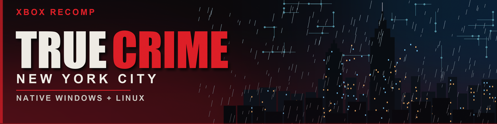

<h1 align="center">
  
</h1>

<p align="center">
  <strong>A native Windows and Linux recompilation port of the original Xbox game, with modern graphics and input options.</strong>
</p>

<p align="center">
  <a href="../../releases/latest"></a>
  
  <a href="LICENSE"></a>
  
</p>

<p align="center">
  <a href="../../releases/latest"><strong>Download</strong></a> ·
  <a href="README-LINUX.md">Linux / SteamOS guide</a> ·
  <a href="#building-from-source">Build from source</a> ·
  <a href="../../issues">Report an issue</a>
</p>

> [!IMPORTANT]
> **No game assets are included.** You must provide the files from your own legally acquired copy of the Xbox game. The port checks that the game files match the release it was built from. This is an unofficial fan project, not affiliated with or endorsed by Activision or the original developers.

## What is this?

True Crime: New York City — Xbox Recomp is an unofficial native PC port of the original Xbox release. The game is statically recompiled to C++ and runs directly on **Windows (Direct3D 12)** and **Linux (Vulkan)** — no emulator and no Proton.

The port adds a modern graphics menu, widescreen support, controller and raw mouse input, texture replacement, save durability fixes, and a native Linux/SteamOS build. It was created with [Xbox XBE Recomp](https://github.com/TGP482/XboxXBE-Recomp).

## Quick start

| | Windows | Linux / SteamOS |
|---|---|---|
| **Download** | [TrueCrimeNYC.zip](../../releases/latest) | [TrueCrimeNYC-linux-x86_64.tar.gz](../../releases/latest) |
| **Install** | Extract, then put your game files in `assets/` | Extract, then put your game files in `assets/` |
| **Run** | `TrueCrimeNYC.exe` | `./TrueCrimeNYC` |
| **Renderer** | Direct3D 12 | Vulkan (leave Proton **off** in Steam) |

- **Windows launcher:** you can select your `.iso` instead of extracting it. The launcher copies the ISO into `assets/`, so allow space for one copy. If the files are already in `assets/`, click **Launch** without browsing.
- **Linux:** `--assets <folder>` and `--iso <image>` also work. See the [Linux / SteamOS guide](README-LINUX.md) for Steam Deck steps and paths.
- **First launch compiles the game code** and can take a while. Later launches reuse the cache.

## Highlights

- **Native renderers** — Direct3D 12 on Windows, Vulkan on Linux; no emulator and no Proton.
- **Modern graphics** — render scale, aspect ratio, field of view, MSAA, SMAA, bloom and depth of field.
- **Controller and mouse** — Xbox, PlayStation and Switch controllers with hot-plug, rumble and adaptive glyphs; raw mouse aim with separate sensitivity.
- **Texture tools** — dump textures and load PNG/DDS replacement packs shared between Windows and Linux.
- **Quality of life** — 30/60 FPS limiter, Unicode and long-path support, durable saves and a keyboard/mouse/controller graphics menu.

## Graphics menu

Press **F10**, or **Back + Start** on controller 1, at any time. Use the arrow keys or D-pad to move and change values, **Enter** or **A** to select, and **Esc** or **B** to close. The mouse works too.

The game receives no controller input while the menu is open, so pause the game first during play. Settings are saved when the menu closes.

<details>
<summary><strong>Full graphics options</strong></summary>

| Option | Values and notes |
|---|---|
| Display mode | Fullscreen, Borderless or Windowed. |
| Resolution | Desktop or any mode the monitor lists. Apply with **Apply display changes**. |
| Aspect ratio | Auto, 4:3, 16:10, 16:9, 21:9 or 32:9. The 3D view widens; HUD, menus and movies stay 16:9 in the middle. |
| Render scale | 25% to 200% of the output height. |
| Field of view | 80% to 150% of the game's view, gameplay camera only; aiming still zooms. |
| Anisotropic filtering | Game default, 2x, 4x, 8x or 16x. |
| MSAA | Off, 2x, 4x or 8x. 2x by default. |
| SMAA | SMAA 1x anti-aliasing on the finished frame. On by default. |
| Bloom | Optional bright-pass bloom over the game's lighting. On by default. |
| Depth of field | Distance blur for 3D scenes. Requires MSAA. On by default. |
| Building seam fix | Experimental: gives detailed buildings priority over simplified city meshes. On by default. |
| PC contrast | Softer shadow roll-off inspired by the PC version. On by default. |
| V-Sync / Frame limit | V-Sync on/off; 30 or 60 FPS. The game's timing is built for at most 60. |
| FPS counter | On or off. |
| Texture replacement / dumping | Enable replacement packs; dump to PNG or DDS. |

Several of these also appear in the game's own **Options > Display** tab. Back cancels and A confirms there, as with the game's options.

</details>

<details>
<summary><strong>Customization</strong></summary>

- **Boot splash:** place `splash.png` or `splash.bmp` beside the executable.
- **Texture replacement:** see the [Linux guide](README-LINUX.md#texture-packs) for the shared folder and naming scheme. Windows uses the same layout.
- **Keys:** use, climb, reload and the optional heavy-attack key can be changed in `settings.toml`. Set `heavy_attack_key = 0` to keep only Left Alt / mouse side button 2.

</details>

## Controls

| Action | Default keyboard / mouse |
|---|---|
| Move | `WASD` |
| Fire | Left mouse |
| Precision aim | Right or middle mouse |
| Reload / block | `R` |
| Use / action | `E` |
| Jump / climb | `Space` or `G` |
| Crouch | `C` |
| Target lock | `Shift` |
| Badge / siren | `Q` |
| Light attack | `Left Ctrl` or mouse side button 1 |
| Heavy attack | `Left Alt` or mouse side button 2 |
| Frisk / grapple / arrest | `V` |
| Weapon / camera | Mouse wheel |
| Pause / map | `Esc` |

**Vehicles:** `W` accelerates, `S` brakes/reverses and `A`/`D` steer when the active camera is in vehicle mode.

<details>
<summary><strong>Controller and input details</strong></summary>

- Xbox, PlayStation and Switch controllers are supported with hot-plugging and rumble.
- On-screen glyphs switch automatically between the active controller and keyboard/mouse.
- Mouse look uses raw input and applies the PC version's camera scale on foot and in vehicles.
- Mouse sensitivity and a separate vertical sensitivity are in the F10 Graphics menu.
- `Enter` confirms menus and `Backspace` cancels.
- The cursor is confined to the game while focused and released for the F10 menu.

</details>

## System requirements

| | Windows | Linux |
|---|---|---|
| **OS** | Windows 10 or 11, 64-bit | 64-bit Linux with glibc 2.38+ (SteamOS 3.6+, Ubuntu 24.04+) |
| **Graphics** | Direct3D 12 GPU | Vulkan 1.1 GPU/driver. MSAA requires Vulkan 1.2; without it MSAA falls back to one sample. |
| **Audio** | — | SDL3 + PulseAudio |
| **Game files** | Your own matching Xbox release, as an ISO or extracted files | Same |
| **Storage** | Space for the game and its assets | Same |

The extracted game files are used when both an ISO and extracted files are present. A different Xbox release is refused, because it would run its own data under this recompiled code.

## Building from source

### Windows

1. Clone the repository with [Git](https://git-scm.com/).
2. Put your game files in `assets/`: `default.xbe` with the game's folders beside it.
3. Install Visual Studio 2022 with **Desktop development with C++**, **C++ Clang tools for Windows** and **C++ CMake tools for Windows**. `build.bat` offers to add the last two.
4. Run `build.bat`. The first build recompiles the game and takes a while. The executable is written to `out\build\release`.

### Linux

The prebuilt package is recommended. A source build needs the generated game code from the recompiler and a matching `assets/default.xbe`. Run the Windows build once to generate `generated/game`, or invoke the recompiler directly.

Install CMake 3.25+, Ninja, a C++20 compiler, SDL3, Vulkan and shaderc development packages, then:

```sh
cmake -S platform/linux -B build/linux -G Ninja -DCMAKE_BUILD_TYPE=Release
cmake --build build/linux --parallel
```

The full CI package list is in [`.github/workflows/linux-package.yml`](.github/workflows/linux-package.yml).

## Beta notes

- This is beta software. Back up saves before trying new settings or builds.
- The first launch compiles game code; later launches reuse the shader cache.
- If the game reports missing assets, check that `assets/default.xbe` and its data folders are present and match this build.
- Logs are written to `logs/` beside the executable. Windows settings are in `settings.toml` beside the executable; Linux paths are in the [Linux guide](README-LINUX.md#paths).
- When reporting a visual problem on Linux, the [Linux troubleshooting section](README-LINUX.md#troubleshooting) explains the F3 trace files to include.

## Credits

- [Xbox XBE Recomp](https://github.com/TGP482/XboxXBE-Recomp) — the recompiler and runtime this port is built on.
- [XenonRecomp](https://github.com/hedge-dev/XenonRecomp) — overridable function layout and instruction hooks.
- [Zydis](https://github.com/zyantific/zydis) — x86 instruction decoding.
- [toml++](https://github.com/marzer/tomlplusplus), [Dear ImGui](https://github.com/ocornut/imgui), [SDL](https://github.com/libsdl-org/SDL) and [SMAA](https://github.com/iryoku/smaa) — configuration, overlay, window/input and anti-aliasing.

See `sdk/THIRD_PARTY.txt`, `sdk/LICENSE` and the `LICENSES/` folder in the release package for the full notices.

## License and disclaimer

The port's source is **MIT-licensed**; see [LICENSE](LICENSE). Game assets, characters and trademarks belong to their respective owners. No game files are included or distributed. This is an unofficial fan project and is not affiliated with or endorsed by Activision or the original developers.
