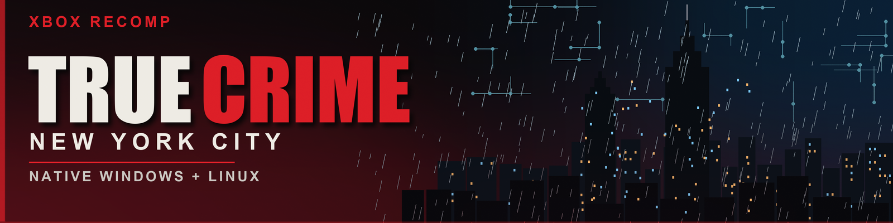

<h1 align="center">
  
</h1>

<p align="center">
  <strong>A native Windows and Linux recompilation port of the original Xbox game, with modern graphics and input options.</strong>
</p>

<p align="center">
  <a href="../../releases/tag/v0.9.2-beta.5"></a>
  
  <a href="LICENSE"></a>
  
</p>

<p align="center">
  <a href="../../releases/tag/v0.9.2-beta.5"><strong>Download</strong></a> ·
  <a href="README-LINUX.md">Linux / SteamOS guide</a> ·
  <a href="#building-from-source">Build from source</a> ·
  <a href="../../issues">Report an issue</a>
</p>

> [!IMPORTANT]
> **No game assets are included.** You must provide the files from your own legally acquired copy of the Xbox game. The launcher detects the supported US NTSC and both European PAL discs (standard and French/Spanish/Italian) by checking their Xbox executable. This is an unofficial fan project, not affiliated with or endorsed by Activision or the original developers.

## What is this?

True Crime: New York City (US NTSC, with experimental European PAL support) — Xbox Recomp is an unofficial native PC port of the original Xbox release. The game is statically recompiled to C++ and runs directly on **Windows (Direct3D 12)** and **Linux (Vulkan)** — no emulator and no Proton.

The port adds a modern graphics menu, widescreen support, controller and raw mouse input, texture replacement, save durability fixes, and a native Linux/SteamOS build. It was created with [Xbox XBE Recomp](https://github.com/TGP482/XboxXBE-Recomp).

## Quick start

| | Windows | Linux / SteamOS |
|---|---|---|
| **Download** | [TrueCrimeNYC.zip](../../releases/tag/v0.9.2-beta.5) | [TrueCrimeNYC-linux-x86_64.tar.gz](../../releases/tag/v0.9.2-beta.5) |
| **Install** | Extract, then put your game files in `assets/` | Extract, then put your game files in `assets/` |
| **Run** | `TrueCrimeNYC.exe` | `./TrueCrimeNYC` |
| **Renderer** | Direct3D 12 (default) or Vulkan (`TCNYC_RENDERER=vulkan`) | Vulkan (leave Proton **off** in Steam) |

- **Windows and Linux launcher:** browse for your Xbox `.iso`, drop it onto the launcher, or choose **Use local assets** if the game is already in `assets/`. The launcher mounts your ISO from its current location and remembers it for the next launch. Open **Graphics** to set the display mode, resolution, render scale, upscaling and other options before starting.
- **Windows Vulkan (experimental):** choose **Vulkan** under **Graphics > Renderer** in the launcher (or set `TCNYC_RENDERER=vulkan`) to use the Vulkan renderer instead of Direct3D 12. It uses the same FSR 4.1/3.1 DLLs with the `_vk` suffix and needs a Vulkan-capable driver.
- **Linux:** `--assets <folder>` and `--iso <image>` also work. See the [Linux / SteamOS guide](README-LINUX.md) for SteamOS handheld steps and paths.
- **First launch compiles the game code** and can take a while. Later launches reuse the cache.

## Highlights

- **Native renderers** - Direct3D 12 on Windows, Vulkan on Linux; no emulator and no Proton. Windows also has an experimental Vulkan renderer (`TCNYC_RENDERER=vulkan`).
- **Almost no loading screens** — the game reads its data straight from your drive instead of a DVD, so loading screens are gone or flash past in a moment. How fast depends on your hardware, mainly the drive the game is installed on.
- **Modern graphics** — render scale, aspect ratio, field of view, object detail, MSAA, SMAA, bloom, depth of field and GTAO ambient occlusion on both platforms, plus sharper and softer shadows.
- **TAA and upscaling** - temporal anti-aliasing with per-object motion, AMD FSR 1 and FSR 3.1 on both platforms, FSR 4.1 on Windows (Direct3D 12 and Vulkan) with a supported AMD GPU, and RCAS sharpening.
- **Steam Deck and handhelds** — a native SteamOS build with Deck button prompts, tested on a Radeon 890M handheld. See the [Linux / SteamOS guide](README-LINUX.md) for setup on SteamOS.
- **Fewer stutters** - compiled pipelines are kept between runs and built at start before the first frame, so effects the game has used before do not hitch the first time they appear. A shader or state seen for the first time is compiled on a worker instead of in a draw.
- **HDR output** — optional HDR on Windows (scRGB or HDR10) and Linux (HDR10 or extended sRGB), with paper white, peak brightness and highlight strength settings.
- **Widescreen** — up to 32:9 for the 3D view, with the HUD and menus kept in the middle and the intro movies stretched to fill the screen.
- **Controller and mouse** — Xbox, PlayStation and Switch controllers with hot-plug, rumble and matching button prompts, including Steam Deck glyphs and Xbox prompts for the ROG Ally and Legion Go under Steam Input. Raw mouse aim works in precision aim and snaps onto a lock-on target; keyboard prompts switch to the pedal keys in a car.
- **European PAL support (experimental)** — the US NTSC disc and both European PAL discs play from the same download; the launcher recognises your disc and starts the right version, with separate saves and settings for each region.
- **Text and subtitles in French, Spanish or Italian** — with the European Fr/Es/It disc, pick the language in the launcher. Voices stay in English.
- **Rebind everything** — keyboard, mouse and controller bindings from the launcher or the F10 menu, with button prompts that follow your choices.
- **Smoother controller aim** — one dead zone for the whole right stick and a gentler curve, with controller and mouse sensitivity in the launcher, F10 and the game's Options > Controller tab.
- **Custom music** — put MP3, OGG, FLAC or WAV songs in the `music` folder to replace the Music Player's songs or add new ones.
- **Audio controls** — pick Mono, Stereo or Dolby Pro Logic II output, force stereo 48 kHz for TVs and soundbars that cut out, and set a master, music, SFX, ambient, voice and cinema volume mix in the launcher.
- **Busier streets** — pedestrian detail, pedestrian limit, crowd density, traffic density and traffic distance settings.
- **Launcher with updates** — a redesigned launcher that checks GitHub for new releases and installs them, keeping your settings, saves and music.
- **Texture tools** — dump textures and load PNG/DDS replacement packs shared between Windows and Linux.
- **Graphics menus** — the F10 overlay (keyboard, mouse or controller) and the game's own **Options > Display** tab, where display changes are applied and confirmed before they are saved. An **Exit Game** option in the main and pause menus closes the game and saves your settings.
- **Copland traffic fix** — restores normal civilian traffic after scripted and random-crime vehicle passes, without reducing police or wanted-level spawns.
- **Car-scrape damage cap** — a passing car can no longer deal thousands of impact damage per second (most noticeable while you enter or exit a vehicle); impact damage to the player is limited to 15% of max health per second.
- **Voice-volume 0 phone-call fix** — phone calls still start (silently) when voice volume is 0, so informant missions and precinct-cleanup messages are not lost.
- **Human Cargo fix** — the button prompt to push the boss off the cargo container no longer has game-breaking timing, so the mission can be finished reliably.
- **Keyboard driving** — full steering stays available while accelerating.
- **Visual fixes** — no ghost copy or dark band from the glow along the frame's edges, building windows show their lit interiors as on the Xbox, and no white flashes in the intro cutscene.
- **Quality of life** — 30/60 FPS limiter, saves written safely at shutdown, Unicode and long-path support, and controllers that can be unplugged and plugged back in at any time.

## Graphics menu

Press **F10**, or **Back + Start** on controller 1, at any time. Use the arrow keys or D-pad to move and change values, **Enter** or **A** to select, and **Esc** or **B** to close. The mouse works too.

The game receives no controller input while the menu is open, so pause the game first during play. Settings are saved when the menu closes. On a small screen the list scrolls and keeps the highlighted row in view.

MSAA is off by default because it is the most demanding option; depth of field works with or without it.

<details>
<summary><strong>Full graphics options</strong></summary>

| Option | Values and notes |
|---|---|
| Display mode | Fullscreen, Borderless or Windowed. |
| Resolution | Desktop or any mode the monitor lists. |
| Apply display changes | Applies the display mode and resolution. A change that fails puts the previous mode back. |
| Aspect ratio | Auto, 4:3, 16:10, 16:9, 21:9 or 32:9. The 3D view widens; HUD and menus stay 16:9 in the middle, and the intro movies stretch to fill the screen. 4:3 and the wide shapes take effect after a restart. |
| Remove cutscene bars | Hides the black bars above and below cutscenes and the title screen, showing the whole 3D picture. Off by default keeps the game's cinematic framing. |
| Render scale | 25% to 200% of the output height. |
| TAA | Temporal anti-aliasing in place of SMAA on the 3D scene, with per-object motion for cars and people. Available on D3D12 and on Vulkan devices with independent blending. Selecting a temporal upscaler replaces TAA. Off by default. |
| Upscaler | Bilinear or AMD FSR 1 below 100% render scale. FSR 3.1 on Windows and Linux, FSR 4.1 on Windows, and optional experimental DLSS use 50% (Performance), 58% (Balanced), 67% (Quality) and 100% (Native AA). Windows FSR uses the AMD SDK loader and upscaler DLLs. DLSS requires an NVIDIA RTX adapter and the platform's NVIDIA runtime; the Windows Vulkan renderer needs a build with NVIDIA's NGX SDK (`TCNYC_DLSS_VK_SDK`). |
| Sharpening | Off to 100%: AMD FidelityFX RCAS sharpening of the 3D frame, at any render scale. The HUD is not sharpened. Off by default. |
| Field of view | 80% to 150% of the game's view, gameplay camera only; aiming still zooms. |
| Object detail | Original, High, Very high or Maximum: how far buildings, props and moving cars keep their detailed models. Parked cars keep the game's own detail level. Maximum is much slower. |
| Pedestrian detail | Original, High, Very high or Maximum: how far away low-detail stand-in pedestrians become full models, and (Very high and Maximum) how far away spawn points fill the street. Maximum also loads characters from their single full-detail files. |
| Pedestrian limit | 15 (Original) to 75: how many full-detail pedestrians at once, and (20 and up) how many pedestrian types load at once, up to 9. Experimental above 30. |
| Crowd density | Original, 1.5x, 2x or 3x (Experimental): how many pedestrians each spawn point keeps. 3x also raises the crowd budget from 250 to 350. |
| Traffic density | Original, 1.5x, 2x, 3x, 4x or 5x (4x and 5x Experimental): the ambient car budget and each road spawn point's cap. |
| Traffic distance | Original (default), 1.5x or 2x: how far away ambient cars appear; they are removed at 4/3 of that range. The car count comes from Traffic density, so a longer distance spreads the same cars more thinly: raise density with it to keep streets busy. |
| Anisotropic filtering | Game default, 2x, 4x, 8x or 16x. |
| MSAA | Off, 2x, 4x or 8x. Off by default: it is the most demanding option. |
| SMAA | SMAA 1x anti-aliasing on the finished frame. On by default. |
| Bloom | Optional bright-pass bloom over the game's lighting. On by default. |
| Bloom strength | 50% to 400% of the original bloom, which is very subtle at 100% (the default). |
| Shadow quality | Original (follows render scale), High (1024x1024) or Ultra (2048x2048) shadow image. Original by default. |
| Shadow softness | Off, Soft or Softer shadow edges. Off by default. |
| Depth of field | Distance blur for 3D scenes. On by default. |
| Ambient occlusion | **Experimental.** GTAO contact shadows in corners and under objects, applied to world geometry only so lights, fog and effects keep their brightness. Off, Half or Full resolution. Off by default. Vertical surfaces (walls, signs and billboards) keep half their AO, which softens the moving band edge there; floors, roads, props and characters keep all of theirs. Windows (D3D12) and Linux (Vulkan). |
| Building seam fix | Experimental: gives detailed buildings priority over simplified city meshes. On by default. |
| PC contrast | Softer shadow roll-off inspired by the PC version. On by default. |
| Gamma | 50% to 250%: display gamma for dark scenes. 100% is unchanged and leaves the picture identical. |
| Brightness | 50% to 150%: scales the whole picture. 100% is unchanged; black stays black, so letterbox bars and fades are not lifted. |
| Contrast | 50% to 150%: expands or compresses tones around mid-grey. 100% is unchanged and separate from PC contrast. |
| Saturation | 0% to 200%: colour strength. 100% is unchanged and 0% is greyscale. |
| HDR | Expands the finished frame's highlights for an HDR display. Off by default, and identical to normal output when off. On Windows it follows the system HDR switch without a restart. |
| HDR paper white / peak / highlights | Brightness of normal white (nits), the brightest highlights (the display's reported peak, or 1000 nits), and how far lamps, neon and headlights are pushed above white. |
| V-Sync / Frame limit | V-Sync on/off; 30 or 60 FPS. The game's timing is built for at most 60. |
| Low latency | Windows: one frame waits for the display instead of three, so the controls respond sooner. Can lower the frame rate on a slow GPU. Off by default. |
| FPS counter | On or off. |
| Texture replacement / dumping | Enable replacement packs; dump to PNG or DDS. |
| Defaults / Close | Defaults resets every option (display changes still need Apply); Close saves and closes the menu. |

The same graphics settings are available in **Options > Display**, with HDR on its own HDR SETTINGS page. Back cancels changes, and A applies a pending display mode or resolution.

The 3D scene renders in higher-precision (FP16) colour on D3D12 and Vulkan when the GPU supports it. Set
`TCNYC_SCENE_FP16=0` before launch to use the original 8-bit scene targets. Guest surfaces retain their original formats.

</details>

<details>
<summary><strong>Customization</strong></summary>

- **Boot splash:** place `splash.png` or `splash.bmp` beside the executable.
- **Texture replacement:** see the [Linux guide](README-LINUX.md#texture-packs) for the shared folder and naming scheme. Windows uses the same layout.
- **Custom music:** drop songs into the `music` folder beside the game. To use another folder, pick it on the
  launcher's Music tab or set `music_folder` in `settings.toml`. A file named after a Music Player song (`6000` to `6092`, as `.mp3`, `.ogg`, `.flac`, `.wav` or `.wma`)
  plays in its place; songs you don't replace stay as they are. MP3, OGG, FLAC and WAV are decoded by the port;
  surround files play in stereo. Any other audio file in the folder is added to the
  Music Player as a new song, already owned (up to 35). Name files `Band - Title.mp3` to show both.
- **Keys:** use, climb, reload and the optional heavy-attack key can be changed in `settings.toml` (see [Settings file](#settings-file)).

</details>

## Controls

| Action | Default keyboard / mouse |
|---|---|
| Move | `WASD` |
| Fire | Left mouse |
| Precision aim | Right or middle mouse |
| Reload / block | `R` |
| Use / action | `E` |
| Jump / climb | `Space` or `G` |
| Crouch | `C` |
| Target lock | `Shift` |
| Badge / siren | `Q` |
| Light attack | `Left Ctrl` or mouse side button 1 |
| Heavy attack | `Left Alt` or mouse side button 2 |
| Frisk / grapple / arrest | `V` |
| Weapon / camera | Mouse wheel |
| Pause / map | `Esc` |

**Vehicles:** `W` accelerates, `S` brakes/reverses and `A`/`D` steer when the active camera is in vehicle mode.

<details>
<summary><strong>Controller and input details</strong></summary>

- Xbox, PlayStation and Switch controllers are supported with hot-plugging and rumble.
- On-screen glyphs switch automatically between the active controller and keyboard/mouse.
- Mouse look uses raw input and applies the PC version's camera scale on foot and in vehicles.
- Controller aim uses a radial dead zone and quadratic response by default, including L2 look. Its Original
  response restores the Xbox behaviour, and its sensitivity raises full-stick turn speed from 100% to 400%.
- Controller aim and mouse sensitivity (with a separate vertical speed) are set on the launcher's Controls
  tab, in the F10 menu, or in the game's Options > Controller tab.
- `Enter` confirms menus and `Backspace` cancels.
- The cursor is confined to the game while focused and released for the F10 menu.
- Button prompts follow the controller in use. If they guess wrong (for example an Xbox pad through Steam Input on a Steam Deck), set `prompt_style` in `settings.toml`.

</details>

## Settings file

Everything in the F10 menu is saved to `settings.toml`: beside the executable on Windows, and in `~/.config/TrueCrimeNYC/settings.toml` on Linux. The file also holds these options:

| Setting | Default | Meaning |
|---|---|---|
| `mouse_sensitivity_percent` | `100` | Mouse look speed, 10 to 400. |
| `mouse_vertical_sensitivity_percent` | `100` | Vertical speed relative to horizontal, 10 to 400. |
| `controller_aim_response` | `0` | `0` is the radial dead zone and quadratic response; `1` is the original Xbox response. |
| `controller_aim_sensitivity_percent` | `100` | Controller turn speed after the curve, 100 to 400 (refined response only). |
| `direct_mouse_aim` | `true` | The mouse turns the camera directly; `false` feeds it to the right stick instead. |
| `music_folder` | `""` | Folder of custom songs (see Customization); empty uses `music` beside the executable, relative paths start there too. |
| `audio_mode` | `1` | Output mix: `0` mono, `1` stereo, `2` Dolby Pro Logic II. |
| `force_stereo_output` | `true` | Windows: open the output device as stereo 48 kHz for TVs and soundbars that cut out or play quietly; off lets the TV or receiver handle Dolby. |
| `force_volume_mix` | `false` | Use the six volumes below instead of the game's Audio menu levels. |
| `sound_volume` | `100` | Forced mix master volume, 0 to 100; scales the categories below. |
| `music_volume` | `100` | Forced mix music volume, 0 to 100. |
| `sfx_volume` | `100` | Forced mix sound-effects volume, 0 to 100. |
| `ambient_volume` | `100` | Forced mix ambient-sound volume, 0 to 100. |
| `voice_volume` | `100` | Forced mix voice volume, 0 to 100. |
| `cinema_volume` | `100` | Forced mix cinema and cutscene volume, 0 to 100. |
| `language` | `"english"` | Text and subtitles on the European Fr/Es/It disc: `"english"`, `"french"`, `"spanish"` or `"italian"`. Set it in `settings-pal.toml`; voices are always English, and the other discs ignore it. |
| `prompt_style` | `0` | Button prompts: 0 automatic, 1 original Xbox, 2 Xbox, 3 PlayStation, 4 Steam Deck. |
| `remove_cutscene_bars` | `false` | `true` hides the black bars above and below cutscenes and the title screen, showing the whole 3D picture. |
| `[controls.keyboard]` | today's layout | Keys per action, e.g. `jump = ["Space", "G"]`; mouse buttons are `MouseLeft`, `MouseMiddle`, `MouseRight`, `Mouse4`, `Mouse5`. |
| `[controls.controller]` | standard layout | The physical button for each console input, e.g. `A = "a"` (SDL names). |

Rebinding is easiest from the launcher's Controls tab or the in-game menu (F10, Controls...); the
button prompts follow your bindings.

Delete the file to return to the defaults.

## System requirements

| | Windows | Linux |
|---|---|---|
| **OS** | Windows 10 or 11, 64-bit | 64-bit Linux with glibc 2.38+ (SteamOS 3.6+, Ubuntu 24.04+) |
| **Graphics** | Direct3D 12 GPU; Vulkan 1.1 GPU/driver for the Vulkan renderer (`TCNYC_RENDERER=vulkan`) | Vulkan 1.1 GPU/driver. MSAA requires Vulkan 1.2; without it MSAA falls back to one sample. |
| **HDR (optional)** | An HDR display with Windows HDR on | An HDR display and an HDR-capable session (for example gamescope with HDR enabled) |
| **Audio** | — | SDL3 + PulseAudio |
| **Game files** | Your own matching Xbox release, as an ISO or extracted files | Same |
| **Storage** | Space for the game and its assets | Same |

Browse to an ISO or enter the path to an extracted game folder. The launcher shows which region it detected. For automatic discovery, use `assets/` for an extracted US copy, `assets-pal/` for European Fr/Es/It, and `assets-pal-eu/` for the other European PAL disc. You can also put the ISOs in `assets/`. Use **Prefer PAL from local assets** to switch when both are available. The PAL builds use separate settings and saves. The Fr/Es/It build uses `settings-pal.toml` and `hdd-pal/`. The other European build uses `settings-pal-eu.toml` and `hdd-pal-eu/`. To reuse saves from a separate PAL installation, copy that installation's `hdd/` into `hdd-pal/` in the new installation.

With the Fr/Es/It disc, pick French, Spanish or Italian text and subtitles under **Language** in the launcher (or set `language = "french"`, `"spanish"`, `"italian"` or `"english"` in `settings-pal.toml`). Voices are always in English. The US and other European PAL discs have English text only.

Both European PAL versions are **experimental** in Beta 4: they have had less testing than the US version, so please report any problem with the log from `logs/`.

Always start `TrueCrimeNYC.exe` (`./TrueCrimeNYC` on Linux), whichever disc you have. The two PAL game executables are in the `regions` folder; the launcher starts the one that matches your disc, so you never need to run them yourself.

## Building from source

### Windows

1. Clone the repository with [Git](https://git-scm.com/).
2. Put your game files in `assets/`: `default.xbe` with the game's folders beside it.
3. Install Visual Studio 2022 or later (or its Build Tools) with **Desktop development with C++**, **C++ Clang tools for Windows** and **C++ CMake tools for Windows**. `build.bat` offers to add the last two.
4. Run `build.bat`. The first build recompiles the game and takes a while. The executable is written to `out\build\release`.

The presets use `clang`, `clang++` and `llvm-rc` from PATH. Release builds need the MSVC-target clang (Visual Studio's or `C:\Program Files\LLVM\bin`); a MinGW-target clang such as llvm-mingw first on PATH stops the Release configure. For a local MinGW build anyway, configure with `-DTCNYC_ALLOW_MINGW_RELEASE=ON`; release packages still refuse it.

- **Release package:** `release.bat` builds `TrueCrimeNYC.zip` from `out\build\release`, with the Visual C++ runtime and the bundled compiler.
- **Developer build and experimental DLSS:** `build-dev.bat` (optionally with an NVIDIA DLSS SDK path) builds into `out\build\dev`; it is never used for releases. See [DEVELOPER.md](DEVELOPER.md) for the `dev` build with the F9 debug menu, building DLSS with NVIDIA's SDK on Windows or Linux, and the switches that help with testing.

### Linux

The prebuilt package is recommended. A source build needs the generated game code from the recompiler and a matching `assets/default.xbe`. Run the Windows build once to generate `generated/game`, or invoke the recompiler directly.

Install CMake 3.25+, Ninja, a C++20 compiler, SDL3, Vulkan and shaderc development packages, then:

```sh
cmake -S platform/linux -B build/linux -G Ninja -DCMAKE_BUILD_TYPE=Release
cmake --build build/linux --parallel
```

On Ubuntu 24.04 the packages are:

```sh
sudo apt-get install build-essential cmake ninja-build pkg-config libvulkan-dev libshaderc-dev \
  libasound2-dev libpulse-dev libudev-dev libx11-dev libxext-dev libxrandr-dev libxi-dev \
  libxcursor-dev libxfixes-dev libxss-dev libxkbcommon-dev libdrm-dev libwayland-dev \
  wayland-protocols libdecor-0-dev libegl1-mesa-dev
```

Ubuntu 24.04 has no `libsdl3-dev`; build SDL 3.4.16 (`release-3.4.16`) from source with `-DSDL_SHARED=OFF -DSDL_STATIC=ON` and install it first. `scripts/package-linux.sh build/linux dist` then makes the release tarball.

## Beta notes

- This is beta software. Back up saves before trying new settings or builds.
- The first launch compiles game code; later launches reuse the shader cache.
- If the game reports missing assets, check that `assets/default.xbe` and its data folders are present and match this build.
- Logs are written to `logs/` beside the executable. Windows settings are in `settings.toml` beside the executable; Linux paths are in the [Linux guide](README-LINUX.md#paths).
- If the game does not start after **HIT THE STREETS**, `logs/launcher.log` records each step of the launcher-to-game handoff.
- [DEVELOPER.md](DEVELOPER.md) lists what to include in a report and switches for more detailed logs.
- When reporting a visual problem on Linux, the [Linux troubleshooting section](README-LINUX.md#troubleshooting) explains the F3 trace files to include.

## Credits

- [Xbox XBE Recomp](https://github.com/TGP482/XboxXBE-Recomp) — the recompiler and runtime this port is built on.
- [XenonRecomp](https://github.com/hedge-dev/XenonRecomp) — overridable function layout and instruction hooks.
- [Zydis](https://github.com/zyantific/zydis) — x86 instruction decoding.
- [toml++](https://github.com/marzer/tomlplusplus), [Dear ImGui](https://github.com/ocornut/imgui), [SDL](https://github.com/libsdl-org/SDL) and [SMAA](https://github.com/iryoku/smaa) — configuration, overlay, window/input and anti-aliasing.
- [AMD FidelityFX FSR 1](https://github.com/GPUOpen-Effects/FidelityFX-FSR) (MIT) — upscaling and sharpening.
- [AMD FidelityFX SDK 2.4](https://github.com/GPUOpen-LibrariesAndSDKs/FidelityFX-SDK/tree/v2.4.0) - optional FSR 3.1 and FSR 4.1 on Direct3D 12 and Vulkan. Windows packages built with the AMD SDK inputs carry both signed DLL pairs and the [SDK licence](https://github.com/GPUOpen-LibrariesAndSDKs/FidelityFX-SDK/blob/v2.4.0/docs/license.md). For a manual install, place the signed loader and upscaler DLLs beside `TrueCrimeNYC.exe` (`_dx12` for Direct3D 12, `_vk` for Vulkan). The older combined `amd_fidelityfx_dx12.dll` also supports FSR 3.1 on Direct3D 12.
- [NVIDIA DLSS](https://github.com/NVIDIA/DLSS) (NVIDIA proprietary) — optional experimental DLSS in developer builds made with NVIDIA's SDK. Release packages do not include it.
- [LLVM / Clang](https://llvm.org/) — the compiler bundled with the Windows release to build the game code on first launch.
- [shaderc](https://github.com/google/shaderc) / [glslang](https://github.com/KhronosGroup/glslang) and [stb](https://github.com/nothings/stb) — run-time shader compilation and texture image loading on Linux.
- Ambient occlusion follows GTAO (Jimenez et al., "Practical Real-Time Strategies for Accurate Indirect Occlusion", 2016) and Intel's [XeGTAO](https://github.com/GameTechDev/XeGTAO).

See `sdk/THIRD_PARTY.txt`, `sdk/LICENSE` and the `LICENSES/` folder in the release package for the full notices.

## License and disclaimer

The port's source is **MIT-licensed**; see [LICENSE](LICENSE). Game assets, characters and trademarks belong to their respective owners. No game files are included or distributed. This is an unofficial fan project and is not affiliated with or endorsed by Activision or the original developers.
